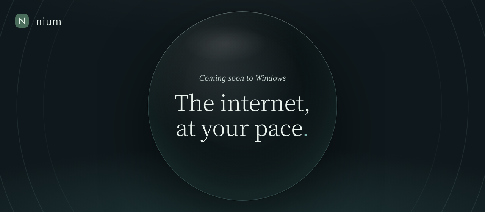

<p align="center">
  
</p>

<p align="center">
  <b>A quiet browser for Windows.</b><br>
  Tabs at your side, a space for each project, ads blocked from the first launch,<br>
  and AI that runs on your computer.
</p>

<p align="center">
  <a href="https://niumbrowser.web.app"></a>
  
  
  <a href="LICENSE"></a>
  <a href="https://github.com/nium-browser/nium-chromium/actions/workflows/build.yml"></a>
</p>

<p align="center">
  <a href="https://niumbrowser.web.app">Website</a> ·
  <a href="https://niumbrowser.web.app/privacy.html">Privacy</a> ·
  <a href="https://niumbrowser.web.app/terms.html">Terms</a> ·
  <a href="README.pt-BR.md">Leia em português</a>
</p>

---

## Why Nium

| | |
|---|---|
| **Tabs at your side** | Titles stay readable with many tabs open, and each project keeps its own space. |
| **You decide what to block** | Nium Shield stops ads, trackers and pop-ups at three levels, and pauses on any site that breaks. |
| **Only the words** | Reader mode leaves just the article, in the size and color you like. It can read aloud too. |
| **AI that stays on your computer** | Summaries, answers and translations from a model that runs inside Nium. Pick **Light** (~400 MB) or **Standard** (1–2 GB); no account, no Ollama needed. |
| **Built on Chromium** | Websites, Google sign-in and Chrome Web Store extensions work like they do in Chrome. |

## Your data stays yours

Nium sends **no telemetry** and needs **no account**. With nothing turned on, what's yours stays on this computer.

- Bookmarks, history, notes and settings live in your profile, on your PC.
- Passwords are kept in an encrypted vault, on your PC.
- Sync is optional and end-to-end encrypted with your passphrase. It goes to **your own** Google Drive or a secret GitHub gist — there is no Nium server.

Read the full [Privacy Policy](https://niumbrowser.web.app/privacy.html).

## Status

Nium is in active development and **not released yet**. It is moving from Electron to its own Chromium base.

- [x] Nium branding on Chromium
- [x] `chrome://nium` — the Nium interface (HTML/CSS/JS) with a bridge to C++
- [ ] Nium sidebar with real tabs — *building now*
- [ ] Nium address bar
- [ ] Features from Nium 1.x: password manager first, then spaces, notes, Shield, reader and AI
- [ ] Glass design (Windows 11 Mica/Acrylic)
- [ ] Installer and auto-updates

Windows only for now.

## Download

Test builds appear under [**Releases**](https://github.com/nium-browser/nium-chromium/releases) when a build finishes: unzip and run `chrome.exe`.

> **Heads-up:** these are early builds. Nium has not had an external security audit yet, so keep your current browser for banking and other sensitive accounts.

## How it's built

Everything Nium-specific lives in [`nium/`](nium). Changes to Chromium's own files are made by a script, so they can be re-applied on every new Chromium version.

```
nium/
├─ browser/ui/webui/   chrome://nium and the bridge (C++)
├─ browser/ui/views/   the Nium sidebar in the browser window (C++)
├─ ui/                 the Nium interface (HTML/CSS/JS)
├─ branding/           icons
└─ scripts/apply.py    applies Nium to a Chromium checkout
ci/                    build scripts (GitHub Actions)
```

Chromium is compiled on GitHub Actions in stages of up to 6 hours, each one resuming where the last stopped ([`ci/build.py`](ci/build.py), [build workflow](.github/workflows/build.yml)). The Chromium version is pinned in [`ci/CHROMIUM_VERSION`](ci/CHROMIUM_VERSION).

**Tweak the interface without compiling:** the Nium UI is plain HTML/CSS/JS. In a build, edit the `nium_ui` folder next to `chrome.exe` and reopen Nium, or point to your own folder with `chrome.exe --nium-ui-dir=<folder>`.

## Contributing

Ideas, bug reports and pull requests are welcome — open an [issue](https://github.com/nium-browser/nium-chromium/issues) first for bigger changes. Questions: **contact@nium.com**.

## License

Nium's code is licensed under the [Mozilla Public License 2.0](LICENSE). Chromium and other third-party components keep their own licenses (see `chrome://credits`).

The **Nium** name and logo are not covered by the license and may not be used for modified versions.

The staged build is based on [ungoogled-chromium-windows](https://github.com/ungoogled-software/ungoogled-chromium-windows) (BSD-3-Clause).

<p align="center"><sub>Made in São Paulo, Brazil.</sub></p>
