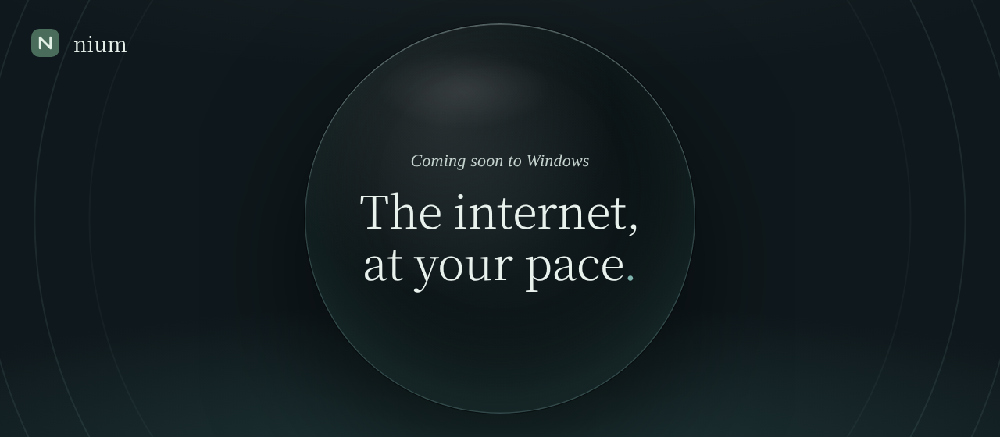

  

  <b>Um navegador tranquilo para Windows.</b> 
  Abas na lateral, um espaço para cada projeto, anúncios bloqueados desde a primeira abertura 
  e uma IA que roda no seu computador.

  <a href="https://niumbrowser.web.app">Site</a> ·
  <a href="https://niumbrowser.web.app/privacy.html">Privacidade</a> ·
  <a href="https://niumbrowser.web.app/terms.html">Termos</a> ·
  <a href="README.md">Read in English</a>

---

## Por que o Nium

| | |
|---|---|
| **Abas na lateral** | Os títulos continuam legíveis com muitas abas abertas, e cada projeto tem o seu espaço. |
| **Você decide o que bloquear** | O Nium Shield barra anúncios, rastreadores e pop-ups em três níveis, e pausa em sites que quebram. |
| **Só as palavras** | O modo leitura deixa só o texto, no tamanho e na cor que você gosta. E também lê em voz alta. |
| **IA que fica no seu computador** | Resumos, respostas e traduções de um modelo que roda dentro do Nium. Escolha **Leve** (~400 MB) ou **Normal** (1–2 GB), sem conta e sem Ollama. |
| **Feito sobre o Chromium** | Sites, login do Google e extensões da Chrome Web Store funcionam como no Chrome. |

## Seus dados são seus

O Nium **não envia telemetria** e **não precisa de conta**. Sem nada ligado, o que é seu fica no seu computador.

- Favoritos, histórico, notas e configurações ficam no seu perfil, no seu PC.
- As senhas ficam num cofre criptografado, no seu PC.
- A sincronização é opcional e criptografada de ponta a ponta com a sua frase. Ela vai para o **seu** Google Drive ou para um gist secreto do GitHub — não existe servidor do Nium.

Leia a [Política de Privacidade](https://niumbrowser.web.app/privacy.html) completa.

## Situação

O Nium está em desenvolvimento e **ainda não foi lançado**. Ele está saindo do Electron para uma base própria no Chromium.

- [x] Marca Nium no Chromium
- [x] `chrome://nium` — a interface do Nium (HTML/CSS/JS) com ponte para o C++
- [ ] Barra lateral do Nium com as abas de verdade — *em construção*
- [ ] Barra de endereço do Nium
- [ ] Recursos do Nium 1.x: primeiro o gerenciador de senhas, depois espaços, notas, Shield, leitura e IA
- [ ] Visual de vidro (Mica/Acrylic do Windows 11)
- [ ] Instalador e atualização automática

Por enquanto, só Windows.

## Baixar

As versões de teste aparecem em [**Releases**](https://github.com/nium-browser/nium-chromium/releases) quando uma compilação termina: descompacte e abra o `chrome.exe`.

> **Atenção:** são versões iniciais. O Nium ainda não passou por auditoria de segurança externa, então mantenha o seu navegador atual para banco e outras contas sensíveis.

## Como é feito

Tudo o que é do Nium fica em [`nium/`](nium). As mudanças nos arquivos do Chromium são feitas por script, para poderem ser reaplicadas a cada versão nova do Chromium. O Chromium é compilado no GitHub Actions em etapas de até 6 horas ([`ci/build.py`](ci/build.py)).

**Mudar a interface sem compilar:** a interface do Nium é HTML/CSS/JS. Numa versão compilada, edite a pasta `nium_ui` ao lado do `chrome.exe` e reabra o Nium, ou use `chrome.exe --nium-ui-dir=<pasta>`.

## Contribuir

Ideias, relatos de bugs e pull requests são bem-vindos — para mudanças maiores, abra uma [issue](https://github.com/nium-browser/nium-chromium/issues) antes. Dúvidas: **contact@nium.com**.

## Licença

O código do Nium está sob a [Mozilla Public License 2.0](LICENSE). O Chromium e os demais componentes seguem as próprias licenças (veja `chrome://credits`). O nome e o logotipo **Nium** não fazem parte da licença e não podem ser usados em versões modificadas.

Feito em São Paulo, Brasil.

